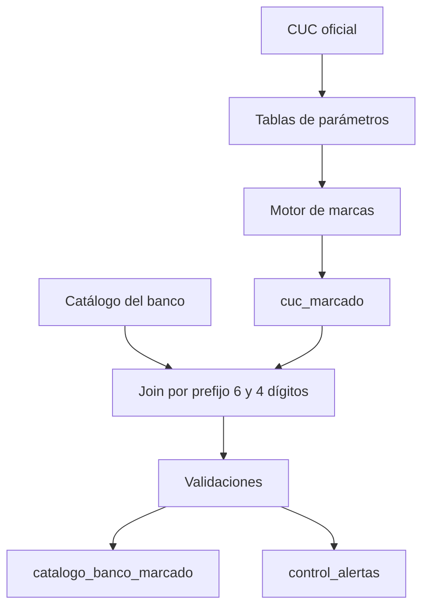

# Marcas de cartera de créditos (cuenta 14) según el CUC

> Fuente: CUC de la Superintendencia de Bancos, plan de cuentas de activos actualizado con
> la Resolución SB-2021-0403 (22-feb-2021),
> [PDF oficial](https://www.superbancos.gob.ec/bancos/wp-content/uploads/downloads/2022/01/CUC-plan-cuentas-activos-28-dic-21.pdf).
> El grupo 14 extraído está en `datos/cuc_grupo14_sb_2021_0403.csv` (230 cuentas).
> Antes de cada corte conviene revisar si hay resoluciones posteriores que reformen el grupo 14.

## 1. Lógica posicional

La cuenta de 4 dígitos `14NN` codifica estado, tipo y segmento en bloques regulares de
3 estados × 3 tipos × 8 posiciones (1401–1472). Con `n = NN − 1`:

| Dimensión | Fórmula | Valores |
|---|---|---|
| Estado | `n / 24` (entera) | 0 Por vencer, 1 No devenga intereses, 2 Vencida |
| Tipo | `(n % 24) / 8` | 0 Original, 1 Refinanciada, 2 Reestructurada |
| Segmento | `n % 8` | 0 Productivo, 1 Consumo, 2 Inmobiliario, 3 Microcrédito, 4–6 sin cuenta, 7 Vivienda de interés social y público |

Las posiciones 4–6 de cada bloque (p. ej. 1405–1407, 1429–1431) no existen en el CUC: el
bloque tiene 45 cuentas, no 72. Una cuenta en esas posiciones queda sin marca.

Ejemplo: 1452 → n = 51 → estado 2, tipo 0, segmento 3 → microcrédito vencido original.

| Rango | Estado | Tipo |
|---|---|---|
| 1401–1408 | Por vencer | Original |
| 1409–1416 | Por vencer | Refinanciada |
| 1417–1424 | Por vencer | Reestructurada |
| 1425–1432 | No devenga | Original |
| 1433–1440 | No devenga | Refinanciada |
| 1441–1448 | No devenga | Reestructurada |
| 1449–1456 | Vencida | Original |
| 1457–1464 | Vencida | Refinanciada |
| 1465–1472 | Vencida | Reestructurada |

### Dónde se rompe el patrón (excepciones)

| Cuentas | Contenido | Marca |
|---|---|---|
| 1473–1490 | Educativo e inversión pública alternados (impar educativo, par inversión pública), en bloques de 6 por estado y de 2 por tipo | Estado, tipo y segmento por excepción |
| 1491–1493 | Refinanciada COVID-19 por vencer / no devenga / vencida | `COVID19`, sin segmento a 4 dígitos |
| 1494–1496 | Reestructurada COVID-19 por vencer / no devenga / vencida | `COVID19`, sin segmento a 4 dígitos |
| 1491xx–1496xx | Subcuenta por segmento: 05 productivo, 20 consumo, 30 inmobiliario, 35 vivienda de interés social y público, 40 microcrédito, 45 inversión pública, 50 educativo | Excepción de 6 dígitos (no es banda) |
| 1499 | Provisiones, signo −1 | `PROVISION` |
| 1499xx | 05, 10, 15, 20, 40, 55, 60 por segmento; 45 refinanciada; 50 reestructurada; 80, 85, 87, 89 genéricas | Segmento o tipo cuando aplica |

### Bandas de días (subcuentas `14NNSS`)

Solo la cartera **por vencer** tiene subcuentas de plazo al vencimiento, iguales para todos
los segmentos (incluidos educativo e inversión pública): 05: 1–30, 10: 31–90, 15: 91–180,
20: 181–360, 25: más de 360 días. En esta versión del CUC las cuentas que no devengan
intereses y las vencidas **no tienen subcuentas de días**.

### Subsegmentos

El CUC define subsegmentos en la descripción de las cuentas (productivo corporativo,
empresarial y PYMES; microcrédito minorista, de acumulación simple y de acumulación
ampliada; subsegmentos de vivienda de interés social y público), pero **no les asigna
código**: pide a las entidades llevar "registros adicionales". Por eso no se derivan del
código CUC. Solo se pueden marcar si el catálogo interno del banco los separa en cuentas
propias o desde la información por operación.

## 2. Proceso



## 3. Modelo de tablas

Todas las tablas de parámetros llevan `fecha_desde` y `fecha_hasta`; el proceso usa la
versión vigente a la `fecha_corte`, lo que permite reprocesar meses pasados.

### Parámetros
| Tabla | Campos | Regla |
|---|---|---|
| `param_regla_posicional` | cuenta_raiz ('14'), pos_inicio (3), longitud (2), rango_desde (1), rango_hasta (72), bloque_estado (24), bloque_tipo (8) | Si NN está en el rango, se aplican las fórmulas con estos bloques |
| `param_estado` | ordinal, codigo, descripcion, es_improductiva (S/N), palabra_clave | palabra_clave sirve solo para validar |
| `param_tipo` | ordinal, codigo, descripcion | |
| `param_segmento` | ordinal, codigo, descripcion | |
| `param_excepcion` | cuenta_cuc, estado, tipo, segmento, marca_especial, signo | La excepción gana sobre la regla; 1499 → PROVISION, signo −1 |
| `param_banda` | estado, segmento (nulo = todos), sufijo, dias_desde, dias_hasta | Busca coincidencia exacta; si no, la genérica con segmento nulo |

### Resultado
| Tabla | Campos | Regla |
|---|---|---|
| `cuc_marcado` | cuenta_cuc, nivel, estado, tipo, segmento, dias_desde, dias_hasta, es_improductiva, signo, origen_marca (REGLA/EXCEPCION), fecha_corte | Una fila por cuenta CUC de 4 y 6 dígitos |
| `catalogo_banco_marcado` | cuenta_banco, cuenta_cuc_match, nivel_match, marcas… | Gana el prefijo más largo (6, luego 4) |

### Control
| Tabla | Campos |
|---|---|
| `control_alertas` | cuenta, regla_fallida, detalle, fecha_proceso |

## 4. Validaciones
1. Cobertura: toda cuenta 14 del banco tiene marca; si no, el proceso se detiene.
2. Unicidad: una sola marca vigente por cuenta CUC.
3. Consistencia: el nombre oficial contiene la palabra_clave del estado asignado.
4. Bandas sin traslapes ni huecos por estado y segmento.
5. Cuentas nuevas del CUC sin marca ni excepción.

## 5. Métricas
- Cartera bruta = cuenta 14 sin provisiones (1499).
- Cartera improductiva = estados con es_improductiva = 'S' (no devenga + vencida).
- Morosidad = cartera improductiva / cartera bruta.

## 6. Implementación en SQL Server

Ajustes respecto al modelo de arriba:

- Esquema `marcas`. Entradas: `cuc_oficial` (CUC publicado, con vigencia) y `catalogo_banco`.
- `param_tipo` y `param_segmento` también llevan `palabra_clave` (solo para la prueba de
  CUC completo). `ordinal` nulo = solo asignable por excepción (segmentos > 1472).
- `param_excepcion` acepta cuentas de 4 o 6 dígitos; la de 4 cubre sus subcuentas salvo
  que exista una de 6.
- `n = NN − rango_desde` (con `rango_desde = 1` equivale a `NN − 1`).
- La regla marca solo si resuelve estado, tipo y segmento; si no, la cuenta queda sin marca.
- Una excepción de 6 dígitos define la subcuenta completa y no busca banda (COVID-19 y
  provisiones); una de 4 dígitos deja que sus subcuentas tomen la banda por sufijo
  (educativo e inversión pública por vencer).
- Los segmentos pueden tener huecos de ordinal; estados y tipos no.
- `control_alertas` agrega `fecha_corte` y `severidad` (BLOQUEANTE detiene el proceso).
- Del catálogo del banco solo se marcan cuentas de 4 o más dígitos dentro de la raíz.

Orden del proceso (`marcas.usp_proceso_marcas`): validar parámetros → marcar CUC →
marcar catálogo del banco → validar resultados.

## 7. Motor (borrador original, SQL genérico)

```sql
SELECT c.cuenta,
  COALESCE(x.estado, e.codigo) AS estado,
  CASE WHEN x.cuenta_cuc IS NOT NULL THEN 'EXCEPCION' ELSE 'REGLA' END AS origen
FROM cuc c
CROSS JOIN param_regla_posicional r
LEFT JOIN param_excepcion x
  ON x.cuenta_cuc = LEFT(c.cuenta, 4)
LEFT JOIN param_estado e
  ON e.ordinal = (CAST(SUBSTRING(c.cuenta, r.pos_inicio, r.longitud) AS INT) - 1) / r.bloque_estado
WHERE c.cuenta LIKE r.cuenta_raiz || '%';
```

Tipo y segmento: `% bloque_estado / bloque_tipo` y `% bloque_tipo`.
Falta agregar filtros de vigencia por fecha_corte y adaptar al dialecto del motor.
