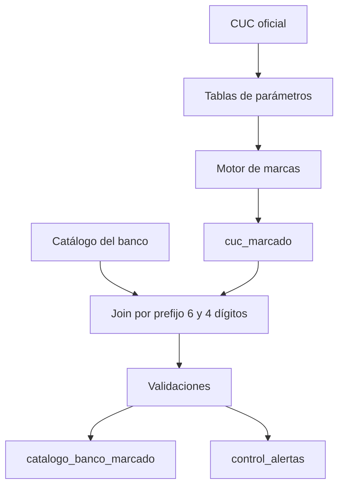

# Marcas de cartera de créditos (cuenta 14) según el CUC

> Advertencia: los rangos, el orden de segmentos y las bandas descritos aquí provienen de
> memoria y deben validarse contra la versión vigente del CUC publicada por la
> Superintendencia de Bancos antes de cargarse como parámetros.

## 1. Lógica posicional

La cuenta de 4 dígitos `14NN` codifica estado, tipo y segmento en bloques regulares:
8 segmentos × 3 tipos × 3 estados = 72 cuentas (1401–1472).

Con `n = NN − 1`:

| Dimensión | Fórmula | Valores |
|---|---|---|
| Estado | `n / 24` (entera) | 0 Por vencer (vigente), 1 No devenga intereses, 2 Vencida |
| Tipo | `(n % 24) / 8` | 0 Original, 1 Refinanciada, 2 Reestructurada |
| Segmento | `n % 8` | 0 Comercial prioritario, 1 Consumo prioritario, 2 Inmobiliario, 3 Microcrédito, 4 Productivo, 5 Comercial ordinario, 6 Consumo ordinario, 7 Vivienda de interés público |

Ejemplo: 1452 → n = 51 → estado 2, tipo 0, segmento 3 → microcrédito vencido original.

Rangos resultantes:

| Rango | Estado | Tipo |
|---|---|---|
| 1401–1408 | Por vencer | Original |
| 1409–1416 | Por vencer | Refinanciada |
| 1417–1424 | Por vencer | Reestructurada |
| 1425–1432 | No devenga | Original |
| 1433–1440 | No devenga | Refinanciada |
| 1441–1448 | No devenga | Reestructurada |
| 1449–1456 | Vencida | Original |
| 1457–1464 | Vencida | Refinanciada |
| 1465–1472 | Vencida | Reestructurada |

### Dónde se rompe el patrón
- Cuentas > 1472 (segmentos agregados después, p. ej. educativo, inversión pública) y la
  1499 (provisiones): van en la tabla de excepciones.
- Subcuentas de 6 dígitos (`14NNSS`): el sufijo es un ordinal de banda.
  - Por vencer y no devenga: bandas uniformes de plazo al vencimiento
    (05: 1–30, 10: 31–90, 15: 91–180, 20: 181–360, 25: >360 días).
  - Vencida: el rango de días de mora depende del segmento → tabla de bandas por segmento.

## 2. Proceso



## 3. Modelo de tablas

Todas las tablas de parámetros llevan `fecha_desde` y `fecha_hasta`; el proceso usa la
versión vigente a la `fecha_corte`, lo que permite reprocesar meses pasados.

### Parámetros
| Tabla | Campos | Regla |
|---|---|---|
| `param_regla_posicional` | cuenta_raiz ('14'), pos_inicio (3), longitud (2), rango_desde (1), rango_hasta (72), bloque_estado (24), bloque_tipo (8) | Si NN está en el rango, se aplican las fórmulas con estos bloques |
| `param_estado` | ordinal, codigo, descripcion, es_improductiva (S/N), palabra_clave | palabra_clave sirve solo para validar |
| `param_tipo` | ordinal, codigo, descripcion | |
| `param_segmento` | ordinal, codigo, descripcion | |
| `param_excepcion` | cuenta_cuc, estado, tipo, segmento, marca_especial, signo | La excepción gana sobre la regla; 1499 → PROVISION, signo −1 |
| `param_banda` | estado, segmento (nulo = todos), sufijo, dias_desde, dias_hasta | Busca coincidencia exacta; si no, la genérica con segmento nulo |

### Resultado
| Tabla | Campos | Regla |
|---|---|---|
| `cuc_marcado` | cuenta_cuc, nivel, estado, tipo, segmento, dias_desde, dias_hasta, es_improductiva, signo, origen_marca (REGLA/EXCEPCION), fecha_corte | Una fila por cuenta CUC de 4 y 6 dígitos |
| `catalogo_banco_marcado` | cuenta_banco, cuenta_cuc_match, nivel_match, marcas… | Gana el prefijo más largo (6, luego 4) |

### Control
| Tabla | Campos |
|---|---|
| `control_alertas` | cuenta, regla_fallida, detalle, fecha_proceso |

## 4. Validaciones
1. Cobertura: toda cuenta 14 del banco tiene marca; si no, el proceso se detiene.
2. Unicidad: una sola marca vigente por cuenta CUC.
3. Consistencia: el nombre oficial contiene la palabra_clave del estado asignado.
4. Bandas sin traslapes ni huecos por estado y segmento.
5. Cuentas nuevas del CUC sin marca ni excepción.

## 5. Métricas
- Cartera bruta = cuenta 14 sin provisiones (1499).
- Cartera improductiva = estados con es_improductiva = 'S' (no devenga + vencida).
- Morosidad = cartera improductiva / cartera bruta.

## 6. Motor (borrador, SQL genérico)

```sql
SELECT c.cuenta,
  COALESCE(x.estado, e.codigo) AS estado,
  CASE WHEN x.cuenta_cuc IS NOT NULL THEN 'EXCEPCION' ELSE 'REGLA' END AS origen
FROM cuc c
CROSS JOIN param_regla_posicional r
LEFT JOIN param_excepcion x
  ON x.cuenta_cuc = LEFT(c.cuenta, 4)
LEFT JOIN param_estado e
  ON e.ordinal = (CAST(SUBSTRING(c.cuenta, r.pos_inicio, r.longitud) AS INT) - 1) / r.bloque_estado
WHERE c.cuenta LIKE r.cuenta_raiz || '%';
```

Tipo y segmento: `% bloque_estado / bloque_tipo` y `% bloque_tipo`.
Falta agregar filtros de vigencia por fecha_corte y adaptar al dialecto del motor.
